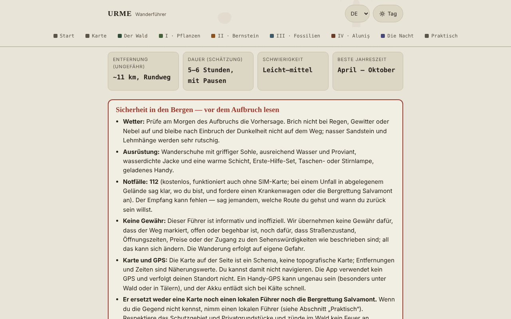

# URME — Wanderführer Aluniș–Colți (Buzău-Gebirge)

[English](README.md) · [Română](README.ro.md) · [Français](README.fr.md) · [Italiano](README.it.md) · [Español](README.es.md) · [Português](README.pt.md) · **Deutsch** · [Magyar](README.hu.md)

**Version:** 1.2.3 · **Zuletzt aktualisiert:** 2026-10-22

Oberflächensprachen: **Română, English, Français, Italiano, Español, Português (PT), Deutsch, Magyar**

Ein Offline-Führer in einer einzigen HTML-Datei für eine Rundwanderung ab Aluniș Retreat: Wald, Heilpflanzen, Bernstein, Fossilien und das Felsenensemble von Aluniș. Informativ und inoffiziell.

**Online-App:** https://chiuta.github.io/URME/

## Was es ist

URME („Ein Tag in den Schichten des Berges“) ist ein Führer zum Lesen, keine Navigations-App. Er beschreibt eine Runde von etwa 11 km (Schätzung, nicht per GPS gemessen) und 5–6 Stunden mit thematischen Stationen: der Wald und seine Bewohner, Heilpflanzen, der Bernstein von Colți, Fossilien und Relief, die Felsenkirche von Aluniș und ein Abschnitt über den Nachthimmel. Die Seite beginnt mit einem Sicherheitskasten und endet mit einem Abschnitt „Practic“ (Praktisches) (Zusammenfassung, vom Veranstalter veröffentlichte Kontakte, Quellen).

## Funktionen

Im Code geprüft:
- Sichtbarer Kasten „Siguranță în munte“ (Sicherheit in den Bergen): Wetter, Ausrüstung, 112, keine Garantien zu Markierung/Zustand des Weges, Grenzen der Karte und des GPS.
- Eigene schematische SVG-Karte der Runde (ohne externe Kartenkacheln), mit Legende; auf schmalem Bildschirm lässt sie sich seitlich scrollen.
- Einklappbarer Abschnitt „In English — safety and essentials for visitors“ (unter dem Sicherheitskasten, `lang="en"`): die getreue Übersetzung des Kastens „Siguranță în munte“, der Basisdaten (Entfernung, Dauer, Schwierigkeit, Saison) und der Liste „Ce iei cu tine“ (Was du mitnimmst), ohne neue Informationen; der Rest der Seite bleibt auf Rumänisch.
- Ausrüstungsliste mit Häkchen und Zähler („X von 9 bereit“); die Häkchen werden jetzt im Browser gespeichert (siehe „Neue Funktionen“). Die Schaltfläche „Copiază ce îmi mai trebuie“ (Kopiere, was mir noch fehlt) kopiert nur die nicht abgehakten Elemente in die Zwischenablage.
- Tagesplaner (Abschnitt „Pornire“): Für ein Datum und eine Abfahrtszeit berechnet er lokal Sonnenaufgang, Sonnenuntergang und bürgerliche Dämmerung (Gebiet Colți, ca. 45,38° N, 26,40° E, laut Wikipedia, abgerufen am 11. Oktober 2026) in rumänischer Zeit (mit der Umstellung auf Sommer-/Winterzeit), den spätesten empfohlenen Start (6 h Wegzeit + 1 h Reserve) und die Marge zum Sonnenuntergang für die Schätzung von 5–6 h des Führers; er warnt, wenn die Rückkehr nach Sonnenuntergang läge. Vereinfachter astronomischer Algorithmus, am 11. Oktober 2026 gegen einen öffentlichen Rechner für Buzău geprüft (Abweichungen von wenigen Minuten, durch den Ort erklärbar); das Relief wird nicht berücksichtigt.
- Navigation nach Abschnitten mit Hervorhebung des aktuellen Abschnitts; Tag/Nacht-Umschalter (folgt beim Öffnen der Systemeinstellung); Druckstil.
- Einklappbare Abschnitte (Geschichte der Mine, „Alte urme din jur“ (Weitere Spuren in der Umgebung), „De ce se numește URME“ (Warum es URME heißt)).

## Neue Funktionen (1.1.0)

- **Himmelskarte** (Abschnitt „Noaptea“ (Die Nacht)): Du wählst Datum und Uhrzeit (rumänische Zeit, mit der Umstellung auf Sommer-/Winterzeit), und die App zeichnet den Himmel über dem Gebiet Colți–Aluniș (ca. 45,38° N, 26,40° E): Sterne bis zur Helligkeit 5 mag (1627 aus dem Hipparcos-Katalog), die Sternbildfiguren und rumänischen Namen, die Sonne, der Mond (mit gezeichneter Phase) und die Planeten Merkur–Saturn. Unter der Karte erscheint eine Tabelle mit Höhe und Azimut der Himmelskörper, der Mondphase, seinem Auf- und Untergang und einem Hinweis „dunkler Himmel“ (Sonne unter −18° und Mond unter dem Horizont). Die Berechnung erfolgt lokal mit den Ephemeriden aus `fff-kit` (gemessene Fehler: unter 3″ für Sonne, Mond und Planeten gegenüber JPL DE421/423; siehe `fff-kit/docs/ephem.md`).
  - **Grenzen:** Sie zeichnet weder die Milchstraße noch Wolken, Lichtverschmutzung oder Relief (der Berg hebt den realen Horizont an); Sterne schwächer als 5 mag sowie die Planeten Uranus und Neptun (mit bloßem Auge nicht sichtbar) fehlen. Die Karte dient der Planung, nicht der Sicherheit.
- **Die Ausrüstungsliste bleibt erhalten** zwischen Besuchen (`localStorage`, Schlüssel `urme.gear`), ebenso die Häkchen „Figuri“ (Figuren) und „Nume“ (Namen) der Himmelskarte (`urme.sky`). Du kannst über das Fenster „Transparență“ (Transparenz) eine `.fff.json`-Sicherung anlegen (drücke die Version in der Fußzeile).
- **Gedrucktes Feldblatt** (Abschnitt „Pornire“, Schaltfläche „Tipărește fișa de teren“ (Feldblatt drucken)): eine Seite mit Sicherheit, 112, den Lichtzeiten aus dem Planer, der Ausrüstungsliste mit deinen Häkchen und einem QR-Code (lokal erzeugt) zum veröffentlichten Führer. Ohne JavaScript oder ohne das QR-Modul fehlt das Blatt / erscheint es ohne Code.
- **Transparenz** (durch Drücken der Version in der Fußzeile): Netzwerk (0 externe Anfragen), gespeicherte Schlüssel, Datei mit SHA-256.

Die Oberfläche hat 8 Sprachen (RO, EN, FR, IT, ES, PT, DE, HU); der lange Text des Führers bleibt auf Rumänisch, und die Übersetzungen außer Rumänisch sind automatisch und nicht von Muttersprachlern geprüft.

## Das Kit „fff-kit“

In `index.html` eingefügte Module: `core`, `label`, `bundle`, `qr`, `ephem`, `ephem-stars` (insgesamt ca. 455 kB zusätzlich zum Führer). Ohne sie bleibt der Führer voll funktionsfähig (getestet): Die Himmelskarte erscheint nicht. Daten und Lizenzen des Sternkatalogs: `fff-kit/THIRD-PARTY.md` (Hipparcos/ESA, d3-celestial BSD-3-Clause, hipparcos-catalog MIT). `app.json` beschreibt Netzwerk, Berechtigungen und SHA-256.

## Tests

`node tests/fff-r8.test.mjs` (Playwright, Netzwerk gesperrt; 69 Prüfungen): Vollmond am 26. Oktober 2026 und Neumond am 2. August 2027, die Sonne beim Untergang im Planer (unabhängiger NOAA-Algorithmus) an vier Daten, Polaris in einer Höhe ≈ Breitengrad, die Zeitzone Sommer/Winter, Persistenz der Häkchen, `.fff.json`-Bündel, Feldblatt und Druckmodus (einseitiges PDF), axe-core 0 Verstöße (helles und dunkles Design, 360 px, Dialog), ohne das Kit.

## Anleitung

1. Lies den Kasten „Siguranță în munte“, bevor du die Wanderung planst.
2. Gehe „Pornire“ durch (was du mitnimmst, Regeln, Jahreszeiten) und hake die Ausrüstungsliste ab.
3. Konsultiere „Hartă“ (Karte) für die Reihenfolge der Stationen; nutze sie nicht zur Navigation.
4. Lies die Etappen (Plante, Chihlimbar, Fosile, Aluniș, Noaptea) in der gewünschten Reihenfolge über die Navigationsleiste.
5. Unter „Practic“ findest du die Zusammenfassung und die vom Veranstalter veröffentlichten Kontaktdaten (prüfe sie direkt).
6. Du kannst die Seite drucken; der Tag/Nacht-Umschalter befindet sich in der oberen rechten Ecke.

## Datenschutz und Netzwerk

- **Speicher:** nur `localStorage`, lokal im Browser: `urme.gear` (die Häkchen der Ausrüstungsliste) und `urme.sky` (zwei Einstellungen der Himmelskarte). Es verwendet weder `sessionStorage` noch IndexedDB noch Cookies; du kannst die Daten über „Transparență“ löschen.
- **Netzwerk:** Es stellt keinerlei Netzwerkanfragen (kein `fetch`, keine externen Skripte, Schriften, Bilder oder Karten). Die CSP der Seite blockiert externe Verbindungen. Der einzige externe Link ist `tabara.asfan.online`, der sich nur öffnet, wenn du ihn anklickst.
- **Berechtigungen:** Es fordert keine Berechtigung an (keine Geolokalisierung, keine Kamera, kein Mikrofon). Die App verfolgt deinen Standort nicht.
- Es gibt kein Konto, keine Telemetrie und keine Verkehrsanalyse.

## Grenzen und Warnhinweise

- Informativer, **inoffizieller** Führer; er garantiert nicht, dass der Weg markiert, offen oder begehbar ist, und ersetzt weder die topografische Karte noch den lokalen Führer noch die Bergrettung (Salvamont). Im Notfall: **112**.
- Schematische Karte; die Entfernungen, Dauern und Höhen (~500–650 m) sind Richtwerte und wurden vom Autor nicht per GPS gemessen.
- Heilpflanzen werden aus der Volkstradition dargestellt, zu Bildungszwecken; **sie sind kein medizinischer Rat**. Verzehre keine Pflanzen oder Pilze, die du nicht sicher bestimmen kannst; hole bei jeder therapeutischen Anwendung den Rat eines Arztes oder Apothekers ein.
- Das Gebiet zwischen Colți und Aluniș umfasst ein Naturschutzgebiet; darin ist das Gewinnen von Bernstein oder Fossilien verboten.
- Einige historische Angaben (die Jahreszahlen der Kirche, Maße, die Bernsteinmine, die Schenkung von 1578) stammen aus der Überlieferung oder aus lokalen Quellen und weichen zwischen den Quellen ab; im Text sind sie als nicht verifiziert gekennzeichnet.
- Die Kontaktdaten, Zeiten und Preise des Veranstalters (Centrul de Artă Aluniș) sind die von ihm veröffentlichten und können veraltet sein. Der Führer wird nicht vom Veranstalter erstellt.
- Der Abschnitt über das ASFAN-Lager spiegelt die Sichtweise der Veranstalter wider; unidentifizierte Luft- und Raumfahrtphänomene haben keine bestätigte wissenschaftliche Erklärung.

## Lokal / offline ausführen

Lade `index.html` herunter und öffne sie in einem Browser; sie funktioniert ohne Internet.

## Verlauf / Changelog

### 1.2.3 — 2026-10-22
- fff-kit 1.1.2: PBKDF2 mit 600.000 Iterationen, Schutz vor Clickjacking.

### 1.2.2 — 2026-10-22
- Mobil: Der Text ist mindestens 12 px groß, und Schaltflächen und Felder haben auf schmalen Bildschirmen größere Touch-Flächen.

### 14. Oktober 2026 (v1.1.0)
- Neu: Himmelskarte mit lokalen Ephemeriden, gespeicherte Ausrüstungsliste, gedrucktes Feldblatt mit QR, Fenster „Transparență“ (fff-kit: core, label, bundle, qr, ephem, ephem-stars); `tests/fff-r8.test.mjs`. CSP: Skript-Hash neu berechnet, keine weiteren Änderungen.

### 12. Oktober 2026 (v1.0.0)
- 1.0.0 — 2026-10-12: Die Version und das Datum der letzten Aktualisierung werden in der App angezeigt

### 11. Oktober 2026 (dritter Eintrag)
- Englische Zusammenfassung (Sicherheit, Basisdaten, Ausrüstung) für Besucher, die kein Rumänisch lesen; axe 0 Verstöße bei geöffnetem Abschnitt, im hellen und dunklen Design, bei 1280 und 360 px.

### 11. Oktober 2026 (zweiter Eintrag)
- Tagesplaner (Sonnenaufgang/-untergang/bürgerliche Dämmerung, spätester Start, Marge zum Sonnenuntergang) und Schaltfläche „Copiază ce îmi mai trebuie“ für die Ausrüstungsliste.
- Den Ersatztext „0 din 7 pregătite“ (0 von 7 bereit) korrigiert (die Liste hat 9 Elemente).

### 11. Oktober 2026
- Die Zeiten und der Preis des Veranstalters (Centrul de Artă Aluniș) tragen in der App jetzt den Hinweis, dass sie am 11. Oktober 2026 nicht erneut überprüft werden konnten und dass die angegebene Saison (bis 1. Oktober) beendet ist.
- Prüfung: axe 0 Verstöße, kein horizontaler Überlauf bei 360 px.

## Lizenz

MIT — siehe die Datei `LICENSE`.

## Autor

Alexio — Alexandru-Ionuț Chiuță, Kontakt: alexio@trom.tf

## Zusammenfassung

URME ist ein rumänischsprachiger Offline-Wanderführer in einer einzigen Datei für eine etwa 11 km lange Rundwanderung bei Aluniș und Colți (Buzău-Gebirge, Rumänien): Wald, Heilpflanzen, Bernstein, Fossilien und die Felsenkirche von Aluniș. Er ist informativ und inoffiziell, enthält einen deutlichen Sicherheitshinweis, nutzt eine schematische SVG-Karte (nicht zur Navigation), kein GPS und stellt keine Netzwerkanfragen; seit 1.1.0 speichert er nur die Häkchen der Ausrüstungs-Checkliste und zwei Einstellungen der Sternkarte in localStorage. Er enthält einen lokalen Tageslichtplaner (Sonnenaufgang/-untergang für die Gegend um Colți) und eine Schaltfläche zum Kopieren der fehlenden Ausrüstung. MIT-lizenziert.

Neu in 1.1.0: eine Offline-Sternkarte für die Gegend Colți–Aluniș (Sterne bis Größenklasse 5, Sternbildfiguren, Sonne, Mond mit Phase, Planeten Merkur–Saturn; lokale Ephemeriden), eine dauerhafte Ausrüstungs-Checkliste, ein einseitiges druckbares Feldblatt mit QR-Code zum veröffentlichten Führer und der Dialog „Transparenz“. Oberfläche nur auf Rumänisch; kein Navigationswerkzeug.
