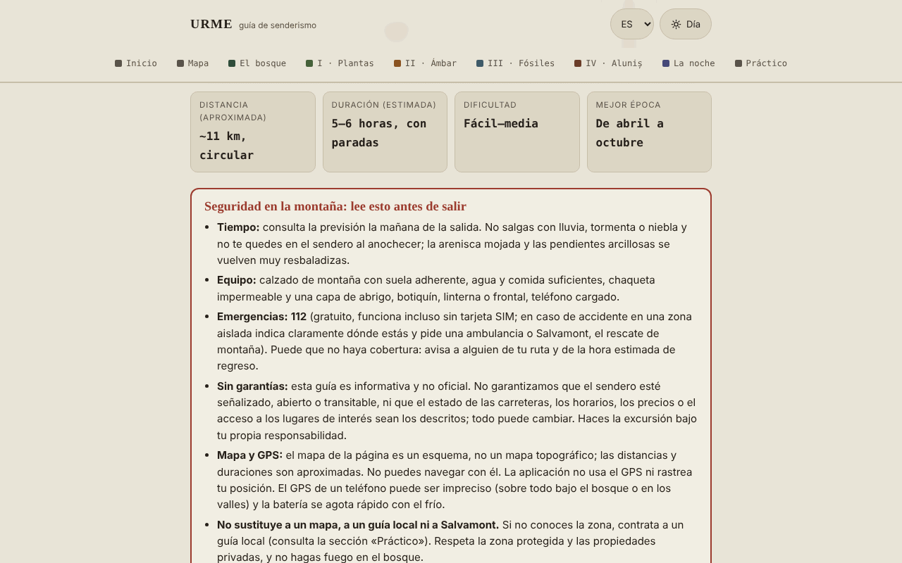

# URME — guía de senderismo Aluniș–Colți (montañas de Buzău)

[English](README.md) · [Română](README.ro.md) · [Français](README.fr.md) · [Italiano](README.it.md) · **Español** · [Português](README.pt.md) · [Deutsch](README.de.md) · [Magyar](README.hu.md)

**Versión:** 1.2.5 · **Última actualización:** 2026-10-23

Idiomas de la interfaz: **Română, English, Français, Italiano, Español, Português (PT), Deutsch, Magyar**

Guía sin conexión, en un único archivo HTML, para una excursión circular que parte de Aluniș Retreat: bosque, plantas medicinales, ámbar, fósiles y el conjunto rupestre de Aluniș. Informativa y no oficial.

**Aplicación en línea:** https://chiuta.github.io/URME/

## Qué es

URME («Un día en los estratos de la montaña») es una guía para leer, no una aplicación de navegación. Describe un bucle de unos 11 km (estimación, no medida con GPS) y de 5–6 horas, con paradas temáticas: el bosque y sus habitantes, las plantas medicinales, el ámbar de Colți, los fósiles y el relieve, la Iglesia de Piedra de Aluniș y una sección sobre el cielo nocturno. La página empieza con un recuadro de seguridad y termina con una sección «Practic» (Práctico) (resumen, contactos publicados por el organizador, fuentes).

## Funciones

Comprobadas en el código:
- Recuadro visible «Siguranță în munte» (Seguridad en la montaña): clima, equipo, 112, ausencia de garantías sobre el señalizado/estado del sendero, límites del mapa y del GPS.
- Mapa esquemático SVG propio del bucle (sin teselas de mapa externas), con leyenda; en pantalla estrecha se desplaza lateralmente.
- Sección plegable «In English — safety and essentials for visitors» (bajo el recuadro de seguridad, `lang="en"`): traducción fiel del recuadro «Siguranță în munte», de los datos básicos (distancia, duración, dificultad, temporada) y de la lista «Ce iei cu tine» (Qué llevas contigo), sin información nueva; el resto de la página sigue en rumano.
- Lista de equipo con casillas y contador («X de 9 preparados»); las casillas marcadas se conservan ahora en el navegador (véase «Novedades»). El botón «Copiază ce îmi mai trebuie» (Copiar lo que aún me falta) copia al portapapeles solo los elementos sin marcar.
- Planificador del día (sección «Pornire»): para una fecha y una hora de salida calcula localmente el amanecer, el atardecer y el crepúsculo civil (zona de Colți, aprox. 45,38° N, 26,40° E, según Wikipedia, consultada el 11 de octubre de 2026), en la hora de Rumanía (con el cambio a horario de verano/invierno), la salida más tardía recomendada (6 h de recorrido + 1 h de reserva) y el margen respecto al atardecer para la estimación de 5–6 h de la guía; avisa si el regreso fuera después del atardecer. Algoritmo astronómico simplificado, verificado el 11 de octubre de 2026 frente a una calculadora pública para Buzău (diferencias de unos minutos, explicables por la ubicación); no tiene en cuenta el relieve.
- Navegación por secciones con resaltado de la sección actual; interruptor día/noche (sigue el ajuste del sistema al abrir); estilo de impresión.
- Secciones plegables (historia de la mina, «Alte urme din jur» (Otras huellas de los alrededores), «De ce se numește URME» (Por qué se llama URME)).

## Novedades (1.1.0)

- **Mapa del cielo** (sección «Noaptea» (La noche)): eliges la fecha y la hora (hora de Rumanía, con el cambio a horario de verano/invierno) y la aplicación dibuja el cielo sobre la zona Colți–Aluniș (aprox. 45,38° N, 26,40° E): estrellas hasta la magnitud 5 (1627 del catálogo Hipparcos), las figuras y los nombres rumanos de las constelaciones, el Sol, la Luna (con la fase dibujada) y los planetas de Mercurio a Saturno. Bajo el mapa aparece una tabla con la altura y el acimut de los astros, la fase de la Luna, su salida y puesta y una indicación de «cielo oscuro» (Sol por debajo de −18° y Luna bajo el horizonte). El cálculo se hace localmente, con las efemérides de `fff-kit` (errores medidos: menos de 3″ para el Sol, la Luna y los planetas respecto a JPL DE421/423; véase `fff-kit/docs/ephem.md`).
  - **Límites:** no dibuja la Vía Láctea, las nubes, la contaminación lumínica ni el relieve (la montaña eleva el horizonte real); faltan las estrellas más débiles que la magnitud 5 y los planetas Urano y Neptuno (no se ven a simple vista). El mapa es para planificar, no para la seguridad.
- **La lista de equipo se conserva** entre visitas (`localStorage`, clave `urme.gear`), al igual que las casillas «Figuri» (Figuras) y «Nume» (Nombres) del mapa del cielo (`urme.sky`). Puedes hacer una copia de seguridad `.fff.json` desde la ventana «Transparență» (Transparencia) (pulsa la versión en el pie de página).
- **Ficha de campo impresa** (sección «Pornire», botón «Tipărește fișa de teren» (Imprimir la ficha de campo)): una página con la seguridad, el 112, las horas de luz del planificador, la lista de equipo con tus casillas marcadas y un código QR (generado localmente) hacia la guía publicada. Sin JavaScript o sin el módulo QR, la ficha falta / aparece sin código.
- **Transparencia** (al pulsar la versión en el pie de página): red (0 solicitudes externas), claves guardadas, archivo con SHA-256.

La interfaz tiene 8 idiomas (RO, EN, FR, IT, ES, PT, DE, HU); el texto largo de la guía permanece en rumano, y las traducciones distintas del rumano son automáticas y no están verificadas por hablantes nativos.

## El kit «fff-kit»

Módulos integrados en `index.html`: `core`, `label`, `bundle`, `qr`, `ephem`, `ephem-stars` (en total unos 455 kB sobre la guía). Sin ellos la guía sigue siendo plenamente funcional (probado): el mapa del cielo no aparece. Datos y licencias del catálogo estelar: `fff-kit/THIRD-PARTY.md` (Hipparcos/ESA, d3-celestial BSD-3-Clause, hipparcos-catalog MIT). `app.json` describe la red, los permisos y el SHA-256.

## Pruebas

`node tests/fff-r8.test.mjs` (Playwright, red bloqueada; 69 comprobaciones): la Luna llena del 26 de octubre de 2026 y la Luna nueva del 2 de agosto de 2027, el Sol en el ocaso del planificador (algoritmo NOAA independiente) en cuatro fechas, Polaris a una altura ≈ latitud, la zona horaria verano/invierno, la persistencia de las casillas, el paquete `.fff.json`, la ficha y el modo de impresión (PDF de una página), axe-core 0 violaciones (tema claro y oscuro, 360 px, cuadro de diálogo), sin el kit.

## Guía de uso

1. Lee el recuadro «Siguranță în munte» antes de planificar la excursión.
2. Recorre «Pornire» (qué llevas contigo, reglas, estaciones) y marca la lista de equipo.
3. Consulta «Hartă» (Mapa) para el orden de las paradas; no lo uses para navegar.
4. Lee las etapas (Plante, Chihlimbar, Fosile, Aluniș, Noaptea) en el orden que quieras, desde la barra de navegación.
5. En «Practic» encontrarás el resumen y los datos de contacto publicados por el organizador (verifícalos directamente).
6. Puedes imprimir la página; el interruptor día/noche está en la esquina superior derecha.

## Privacidad y red

- **Almacenamiento:** solo `localStorage`, local en el navegador: `urme.gear` (las casillas de la lista de equipo) y `urme.sky` (dos preferencias del mapa del cielo). No usa `sessionStorage`, IndexedDB ni cookies; puedes borrar los datos desde «Transparență».
- **Red:** no realiza ninguna solicitud de red (sin `fetch`, scripts, fuentes, imágenes ni mapas externos). La CSP de la página bloquea las conexiones externas. El único enlace externo es `tabara.asfan.online`, que se abre solo si haces clic en él.
- **Permisos:** no solicita ningún permiso (no usa geolocalización, cámara ni micrófono). La aplicación no sigue tu posición.
- No hay cuenta, telemetría ni análisis de tráfico.

## Límites y advertencias

- Guía informativa, **no oficial**; no garantiza que el sendero esté señalizado, abierto o transitable y no sustituye el mapa topográfico, el guía local ni el Salvamont (rescate de montaña). En caso de emergencia: **112**.
- Mapa esquemático; las distancias, duraciones y altitudes (~500–650 m) son orientativas y el autor no las ha medido con GPS.
- Las plantas medicinales se presentan desde la tradición popular, con fines educativos; **no son consejo médico**. No consumas plantas ni setas que no puedas identificar con seguridad; para cualquier uso terapéutico, consulta a un médico o farmacéutico.
- La zona entre Colți y Aluniș incluye un área natural protegida; dentro de ella está prohibida la extracción de ámbar o fósiles.
- Algunos datos históricos (los años de la iglesia, dimensiones, la mina de ámbar, la donación de 1578) proceden de la tradición o de fuentes locales y difieren entre fuentes; en el texto están marcados como no verificados.
- Los datos de contacto, el horario y las tarifas del organizador (Centrul de Artă Aluniș) son los que él publica y pueden estar desactualizados. La guía no la realiza el organizador.
- La sección sobre el campamento ASFAN refleja la perspectiva de los organizadores; los fenómenos aeroespaciales no identificados no tienen una explicación científica confirmada.

## Ejecución local / sin conexión

Descarga `index.html` y ábrelo en un navegador; funciona sin internet.

## Historial / Changelog

### 1.2.4 — 2026-10-22
- fff-kit 1.1.4: objetivos táctiles y texto mínimo; objetivos táctiles/texto corregidos

### 1.2.3 — 2026-10-22
- fff-kit 1.1.2: PBKDF2 con 600.000 iteraciones, protección anti-clickjacking.

### 1.2.2 — 2026-10-22
- Móvil: el texto mide al menos 12 px y los botones y campos tienen áreas táctiles mayores en pantallas estrechas.

### 14 de octubre de 2026 (v1.1.0)
- Novedad: mapa del cielo con efemérides locales, lista de equipo guardada, ficha de campo impresa con QR, ventana «Transparență» (fff-kit: core, label, bundle, qr, ephem, ephem-stars); `tests/fff-r8.test.mjs`. CSP: hash del script recalculado, sin otros cambios.

### 12 de octubre de 2026 (v1.0.0)
- 1.0.0 — 2026-10-12: la versión y la fecha de la última actualización se muestran en la aplicación

### 11 de octubre de 2026 (tercera entrada)
- Resumen en inglés (seguridad, datos básicos, equipo) para visitantes que no leen rumano; axe 0 violaciones con la sección abierta, en tema claro y oscuro, a 1280 y 360 px.

### 11 de octubre de 2026 (segunda entrada)
- Planificador del día (amanecer/atardecer/crepúsculo civil, salida más tardía, margen respecto al atardecer) y botón «Copiază ce îmi mai trebuie» para la lista de equipo.
- Corregido el texto de reserva «0 din 7 pregătite» (0 de 7 preparados) (la lista tiene 9 elementos).

### 11 de octubre de 2026
- El horario y la tarifa del organizador (Centrul de Artă Aluniș) llevan ahora, en la aplicación, la mención de que no pudieron reverificarse el 11 de octubre de 2026 y de que la temporada indicada (hasta el 1 de octubre) ha terminado.
- Verificación: axe 0 violaciones, sin desbordamiento horizontal a 360 px.

## Licencia

MIT — véase el archivo `LICENSE`.

## Autor

Alexio — Alexandru-Ionuț Chiuță, contacto: alexio@trom.tf

## Resumen

URME es una guía de senderismo de un único archivo, sin conexión y en rumano, para una ruta circular de unos 11 km cerca de Aluniș y Colți (montes Buzău, Rumanía): bosque, plantas medicinales, ámbar, fósiles y la iglesia rupestre de Aluniș. Es informativa y no oficial, tiene un aviso de seguridad destacado, usa un mapa SVG esquemático (no apto para la navegación), no usa GPS y no realiza solicitudes de red; desde la 1.1.0 solo guarda en localStorage las marcas de la lista de equipo y dos preferencias del mapa del cielo. Incluye un planificador local de luz diurna (salida/puesta del sol para la zona de Colți) y un botón para copiar el equipo que falta. Licencia MIT.

Novedades en la 1.1.0: una carta celeste sin conexión para la zona Colți–Aluniș (estrellas hasta magnitud 5, figuras de constelaciones, Sol, Luna con fase, planetas de Mercurio a Saturno; efemérides locales), una lista de equipo persistente, una ficha de campo imprimible de una página con un código QR a la guía publicada y el cuadro de diálogo «Transparencia». Interfaz solo en rumano; no es una herramienta de navegación.
