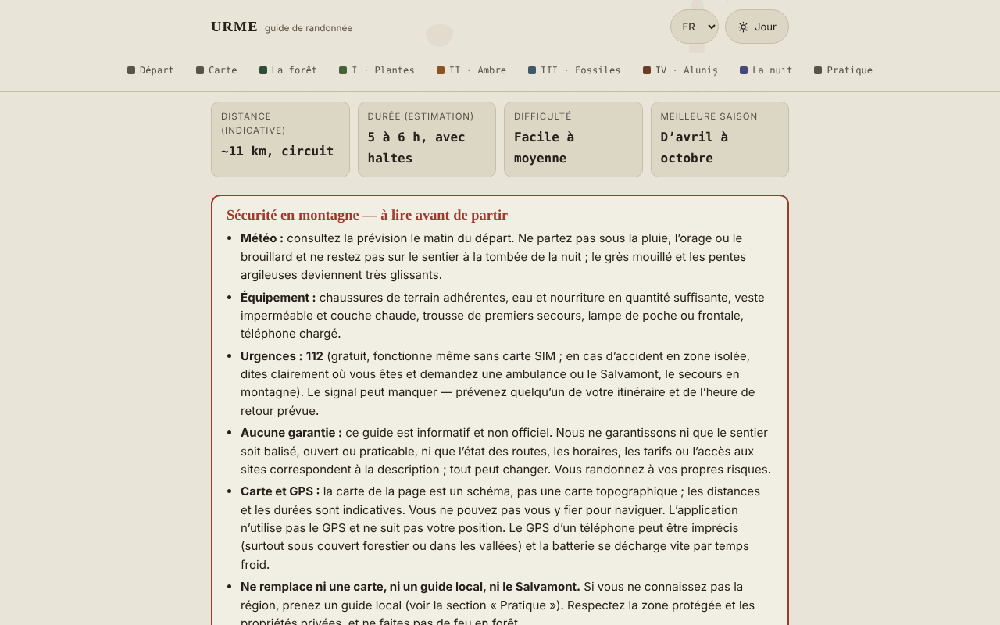

# URME — guide de randonnée Aluniș–Colți (montagnes de Buzău)

[English](README.md) · [Română](README.ro.md) · **Français** · [Italiano](README.it.md) · [Español](README.es.md) · [Português](README.pt.md) · [Deutsch](README.de.md) · [Magyar](README.hu.md)

**Version :** 1.2.6 · **Dernière mise à jour :** 2026-10-23

Langues de l'interface : **Română, English, Français, Italiano, Español, Português (PT), Deutsch, Magyar**

Guide hors ligne, dans un seul fichier HTML, pour une randonnée en boucle au départ d'Aluniș Retreat : forêt, plantes médicinales, ambre, fossiles et l'ensemble rupestre d'Aluniș. Informatif et non officiel.

**Application en ligne :** https://chiuta.github.io/URME/

## Présentation

URME (« Une journée dans les strates de la montagne ») est un guide à lire, non une application de navigation. Il décrit une boucle d'environ 11 km (estimation, non mesurée au GPS) et de 5 à 6 heures, avec des haltes thématiques : la forêt et ses habitants, les plantes médicinales, l'ambre de Colți, les fossiles et le relief, l'église rupestre d'Aluniș et une section sur le ciel nocturne. La page commence par un encadré de sécurité et se termine par une section « Practic » (Pratique) (récapitulatif, contacts publiés par l'organisateur, sources).

## Fonctionnalités

Vérifiées dans le code :
- Encadré visible « Siguranță în munte » (Sécurité en montagne) : météo, équipement, 112, absence de garanties sur le balisage/l'état du sentier, limites de la carte et du GPS.
- Carte schématique SVG propre de la boucle (sans tuiles de carte externes), avec légende ; sur écran étroit, elle défile latéralement.
- Section repliable « In English — safety and essentials for visitors » (sous l'encadré de sécurité, `lang="en"`) : traduction fidèle de l'encadré « Siguranță în munte », des données de base (distance, durée, difficulté, saison) et de la liste « Ce iei cu tine » (Ce que vous emportez), sans information nouvelle ; le reste de la page reste en roumain.
- Liste d'équipement avec cases à cocher et compteur (« X sur 9 prêts ») ; les cases cochées sont désormais conservées dans le navigateur (voir « Nouveautés »). Le bouton « Copiază ce îmi mai trebuie » (Copier ce qu'il me manque) copie dans le presse-papiers uniquement les éléments non cochés.
- Planificateur de journée (section « Pornire ») : pour une date et une heure de départ, il calcule localement le lever, le coucher du soleil et le crépuscule civil (zone de Colți, env. 45,38° N, 26,40° E, d'après Wikipédia, consulté le 11 octobre 2026), à l'heure de la Roumanie (avec le passage à l'heure d'été/d'hiver), le départ le plus tardif recommandé (6 h de parcours + 1 h de réserve) et la marge par rapport au coucher du soleil pour l'estimation de 5 à 6 h du guide ; il avertit si le retour se ferait après le coucher du soleil. Algorithme astronomique simplifié, vérifié le 11 octobre 2026 par rapport à un calculateur public pour Buzău (écarts de quelques minutes, explicables par le lieu) ; il ne tient pas compte du relief.
- Navigation par sections avec mise en évidence de la section courante ; bascule jour/nuit (suit le réglage du système à l'ouverture) ; style d'impression.
- Sections repliables (histoire de la mine, « Alte urme din jur » (Autres traces alentour), « De ce se numește URME » (Pourquoi cela s'appelle URME)).

## Nouveautés (1.1.0)

- **Carte du ciel** (section « Noaptea » (La nuit)) : vous choisissez la date et l'heure (heure de la Roumanie, avec le passage à l'heure d'été/d'hiver) et l'application dessine le ciel au-dessus de la zone Colți–Aluniș (env. 45,38° N, 26,40° E) : étoiles jusqu'à la magnitude 5 (1627 du catalogue Hipparcos), figures et noms roumains des constellations, Soleil, Lune (avec la phase dessinée) et planètes de Mercure à Saturne. Sous la carte apparaît un tableau avec la hauteur et l'azimut des astres, la phase de la Lune, son lever et son coucher et une indication « ciel sombre » (Soleil sous −18° et Lune sous l'horizon). Le calcul est fait localement, avec les éphémérides du `fff-kit` (erreurs mesurées : moins de 3″ pour le Soleil, la Lune et les planètes par rapport à JPL DE421/423 ; voir `fff-kit/docs/ephem.md`).
  - **Limites :** elle ne dessine ni la Voie lactée, ni les nuages, ni la pollution lumineuse, ni le relief (la montagne relève l'horizon réel) ; les étoiles plus faibles que la magnitude 5 et les planètes Uranus et Neptune (invisibles à l'œil nu) sont absentes. La carte sert à la planification, pas à la sécurité.
- **La liste d'équipement est conservée** d'une visite à l'autre (`localStorage`, clé `urme.gear`), de même que les cases « Figuri » (Figures) et « Nume » (Noms) de la carte du ciel (`urme.sky`). Vous pouvez faire une sauvegarde `.fff.json` depuis la fenêtre « Transparență » (Transparence) (appuyez sur la version dans le pied de page).
- **Fiche de terrain imprimée** (section « Pornire », bouton « Tipărește fișa de teren » (Imprimer la fiche de terrain)) : une page avec la sécurité, le 112, les heures de lumière du planificateur, la liste d'équipement avec vos cases cochées et un code QR (généré localement) vers le guide publié. Sans JavaScript ou sans le module QR, la fiche est absente / apparaît sans le code.
- **Transparence** (en appuyant sur la version dans le pied de page) : réseau (0 requête externe), clés enregistrées, fichier avec SHA-256.

L'interface compte 8 langues (RO, EN, FR, IT, ES, PT, DE, HU) ; le long texte du guide reste en roumain, et les traductions autres que le roumain sont automatiques et non vérifiées par des locuteurs natifs.

## Le kit « fff-kit »

Modules intégrés dans `index.html` : `core`, `label`, `bundle`, `qr`, `ephem`, `ephem-stars` (environ 455 ko au total en plus du guide). Sans eux, le guide reste pleinement fonctionnel (testé) : la carte du ciel n'apparaît pas. Données et licences du catalogue d'étoiles : `fff-kit/THIRD-PARTY.md` (Hipparcos/ESA, d3-celestial BSD-3-Clause, hipparcos-catalog MIT). `app.json` décrit le réseau, les autorisations et le SHA-256.

## Tests

`node tests/fff-r8.test.mjs` (Playwright, réseau bloqué ; 69 vérifications) : la pleine Lune du 26 octobre 2026 et la nouvelle Lune du 2 août 2027, le Soleil au coucher dans le planificateur (algorithme NOAA indépendant) à quatre dates, Polaris à une hauteur ≈ latitude, le fuseau horaire été/hiver, la persistance des cases cochées, le paquet `.fff.json`, la fiche et le mode impression (PDF d'une page), axe-core 0 violation (thème clair et sombre, 360 px, boîte de dialogue), sans le kit.

## Mode d'emploi

1. Lisez l'encadré « Siguranță în munte » avant de planifier la randonnée.
2. Parcourez « Pornire » (ce que vous emportez, règles, saisons) et cochez la liste d'équipement.
3. Consultez « Hartă » (Carte) pour l'ordre des haltes ; ne l'utilisez pas pour naviguer.
4. Lisez les étapes (Plante, Chihlimbar, Fosile, Aluniș, Noaptea) dans l'ordre souhaité, depuis la barre de navigation.
5. Dans « Practic », vous trouverez le récapitulatif et les coordonnées publiées par l'organisateur (vérifiez-les directement).
6. Vous pouvez imprimer la page ; la bascule jour/nuit se trouve dans le coin supérieur droit.

## Confidentialité et réseau

- **Stockage :** uniquement `localStorage`, en local dans le navigateur : `urme.gear` (les cases cochées de la liste d'équipement) et `urme.sky` (deux préférences de la carte du ciel). Il n'utilise ni `sessionStorage`, ni IndexedDB, ni cookies ; vous pouvez effacer les données depuis « Transparență ».
- **Réseau :** il n'effectue aucune requête réseau (ni `fetch`, ni scripts, polices, images ou cartes externes). La CSP de la page bloque les connexions externes. Le seul lien externe est `tabara.asfan.online`, qui ne s'ouvre que si vous cliquez dessus.
- **Autorisations :** il ne demande aucune autorisation (il n'utilise ni géolocalisation, ni caméra, ni microphone). L'application ne suit pas votre position.
- Il n'y a ni compte, ni télémétrie, ni analyse de trafic.

## Limites et avertissements

- Guide informatif, **non officiel** ; il ne garantit pas que le sentier soit balisé, ouvert ou praticable et ne remplace ni la carte topographique, ni le guide local, ni le Salvamont (secours en montagne). En cas d'urgence : **112**.
- Carte schématique ; les distances, durées et altitudes (~500–650 m) sont indicatives et n'ont pas été mesurées au GPS par l'auteur.
- Les plantes médicinales sont présentées d'après la tradition populaire, à titre éducatif ; **ce n'est pas un avis médical**. Ne consommez pas de plantes ou de champignons que vous ne pouvez pas identifier avec certitude ; pour tout usage thérapeutique, demandez l'avis d'un médecin ou d'un pharmacien.
- La zone entre Colți et Aluniș comprend une aire naturelle protégée ; à l'intérieur, l'extraction d'ambre ou de fossiles est interdite.
- Certaines données historiques (les années de l'église, les dimensions, la mine d'ambre, la donation de 1578) proviennent de la tradition ou de sources locales et diffèrent selon les sources ; elles sont signalées comme non vérifiées dans le texte.
- Les coordonnées, l'horaire et les tarifs de l'organisateur (Centrul de Artă Aluniș) sont ceux qu'il publie et peuvent être périmés. Le guide n'est pas réalisé par l'organisateur.
- La section sur le camp ASFAN reflète le point de vue des organisateurs ; les phénomènes aérospatiaux non identifiés n'ont pas d'explication scientifique confirmée.

## Exécution en local / hors ligne

Téléchargez `index.html` et ouvrez-le dans un navigateur ; il fonctionne sans internet.

## Historique / Changelog

### 1.2.6 — 2026-10-23
- Planificateur de journée : une heure de retour après minuit s'affiche désormais comme une heure valide (p. ex. 01:00) et non 25:00–26:00 ou 28:30 ; l'avertissement « après le coucher du soleil » est inchangé.
- Sur écrans tactiles (`pointer: coarse`), les petits boutons et les champs date/heure ont une cible tactile de 44 px.

### 1.2.4 — 2026-10-22
- fff-kit 1.1.4 : cibles tactiles et taille de texte minimale; cibles tactiles/texte corrigés

### 1.2.3 — 2026-10-22
- fff-kit 1.1.2 : PBKDF2 à 600 000 itérations, protection anti-clickjacking.

### 1.2.2 — 2026-10-22
- Mobile : le texte fait au moins 12 px et les boutons et champs ont des cibles tactiles plus grandes sur les écrans étroits.

### 14 octobre 2026 (v1.1.0)
- Nouveau : carte du ciel avec éphémérides locales, liste d'équipement enregistrée, fiche de terrain imprimée avec QR, fenêtre « Transparență » (fff-kit : core, label, bundle, qr, ephem, ephem-stars) ; `tests/fff-r8.test.mjs`. CSP : hachage du script recalculé, sans autre changement.

### 12 octobre 2026 (v1.0.0)
- 1.0.0 — 2026-10-12 : la version et la date de la dernière mise à jour sont affichées dans l'application

### 11 octobre 2026 (troisième entrée)
- Résumé en anglais (sécurité, données de base, équipement) pour les visiteurs qui ne lisent pas le roumain ; axe 0 violation avec la section ouverte, en thème clair et sombre, à 1280 et 360 px.

### 11 octobre 2026 (deuxième entrée)
- Planificateur de journée (lever/coucher du soleil/crépuscule civil, départ le plus tardif, marge par rapport au coucher) et bouton « Copiază ce îmi mai trebuie » pour la liste d'équipement.
- Correction du texte de secours « 0 din 7 pregătite » (0 sur 7 prêts) (la liste compte 9 éléments).

### 11 octobre 2026
- L'horaire et le tarif de l'organisateur (Centrul de Artă Aluniș) portent désormais, dans l'application, la mention qu'ils n'ont pas pu être revérifiés le 11 octobre 2026 et que la saison indiquée (jusqu'au 1er octobre) est terminée.
- Vérification : axe 0 violation, pas de débordement horizontal à 360 px.

## Licence

MIT — voir le fichier `LICENSE`.

## Auteur

Alexio — Alexandru-Ionuț Chiuță, contact : alexio@trom.tf

## Résumé

URME est un guide de randonnée hors ligne en roumain, en un seul fichier, pour un circuit d'environ 11 km près d'Aluniș et de Colți (monts Buzău, Roumanie) : forêt, plantes médicinales, ambre, fossiles et l'église rupestre d'Aluniș. Il est informatif et non officiel, comporte un avertissement de sécurité bien visible, utilise une carte SVG schématique (pas pour la navigation), pas de GPS, et n'effectue aucune requête réseau ; depuis la 1.1.0, il ne stocke dans localStorage que les cases cochées de la liste d'équipement et deux préférences de la carte du ciel. Il comprend un planificateur local de lumière du jour (lever/coucher du Soleil pour la région de Colți) et un bouton de copie du matériel manquant. Sous licence MIT.

Nouveau dans la 1.1.0 : une carte du ciel hors ligne pour la région Colți–Aluniș (étoiles jusqu'à la magnitude 5, figures des constellations, Soleil, Lune avec phase, planètes de Mercure à Saturne ; éphémérides locales), une liste d'équipement persistante, une fiche de terrain imprimable d'une page avec un code QR vers le guide publié, et la boîte de dialogue « Transparence ». Interface uniquement en roumain ; ce n'est pas un outil de navigation.

