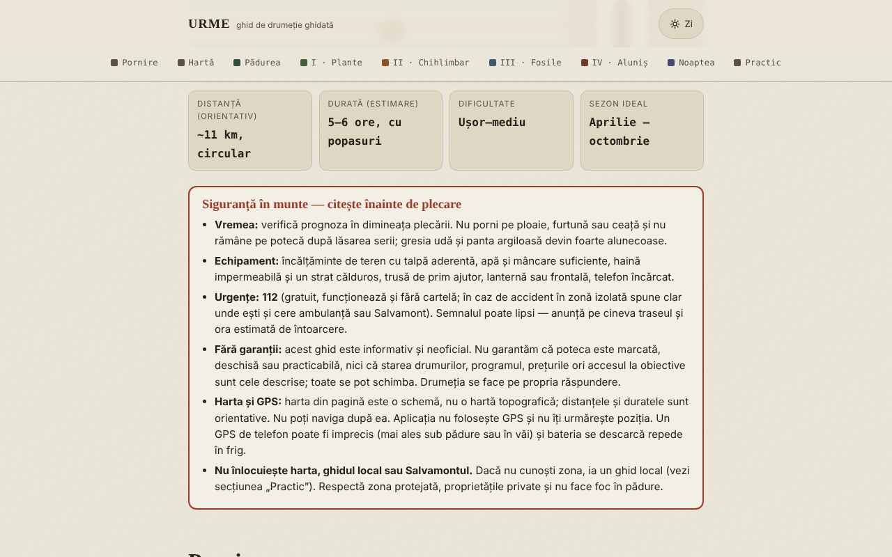

# URME — ghid de drumeție Aluniș–Colți (Munții Buzăului)

Ghid offline, într-un singur fișier HTML, pentru o drumeție circulară care pornește de la Aluniș Retreat: pădure, plante de leac, chihlimbar, fosile și Ansamblul Rupestru Aluniș. Informativ și neoficial.

**Live:** https://chiuta.github.io/URME/

**Ultima actualizare:** 11 octombrie 2026

## Ce este

URME („O zi în straturile muntelui") este un ghid de citit, nu o aplicație de navigație. Descrie o buclă de aproximativ 11 km (estimare, nemăsurată cu GPS) și 5–6 ore, cu popasuri tematice: pădurea și viețuitoarele ei, plante de leac, chihlimbarul de la Colți, fosile și relief, Biserica din Piatră de la Aluniș și o secțiune despre cerul nopții. Pagina începe cu un chenar de siguranță și se termină cu o secțiune „Practic" (recapitulare, contacte publicate de organizator, surse).

## Funcții

Verificate în cod:
- Chenar vizibil „Siguranță în munte": vreme, echipament, 112, lipsa garanțiilor privind marcajul/starea traseului, limitele hărții și ale GPS-ului.
- Hartă schematică SVG proprie a buclei (fără plăci de hartă externe), cu legendă; pe ecran îngust se derulează lateral.
- Listă de echipament cu bife și contor („X din 9 pregătite"); bifele nu se salvează.
- Navigare pe secțiuni cu evidențierea secțiunii curente; comutator zi/noapte (urmărește setarea sistemului la deschidere); stil de tipărire.
- Secțiuni pliabile (istoria minei, „Alte urme din jur", „De ce se numește URME").

## Manual de utilizare

1. Citește chenarul „Siguranță în munte" înainte de a plănui drumeția.
2. Parcurge „Pornire" (ce iei cu tine, reguli, anotimpuri) și bifează lista de echipament.
3. Consultă „Hartă" pentru ordinea popasurilor; nu o folosi pentru navigație.
4. Citește etapele (Plante, Chihlimbar, Fosile, Aluniș, Noaptea) în ordinea dorită, din bara de navigare.
5. În „Practic" găsești recapitularea și datele de contact publicate de organizator (verifică-le direct).
6. Poți tipări pagina; comutatorul zi/noapte e în colțul din dreapta sus.

## Confidențialitate și rețea

- **Stocare:** nu folosește `localStorage`, `sessionStorage`, IndexedDB sau cookie-uri. Nimic nu se salvează.
- **Rețea:** nu face nicio cerere de rețea (fără `fetch`, scripturi, fonturi, imagini sau hărți externe). Politica CSP din pagină blochează conexiunile externe. Singurul link extern este `tabara.asfan.online`, care se deschide doar dacă apeși pe el.
- **Permisiuni:** nu cere nicio permisiune (nu folosește geolocalizare, cameră sau microfon). Aplicația nu îți urmărește poziția.
- Nu există cont, telemetrie sau analiză de trafic.

## Limite și avertismente

- Ghid informativ, **neoficial**; nu garantează că poteca este marcată, deschisă sau practicabilă și nu înlocuiește harta topografică, ghidul local sau Salvamontul. În caz de urgență: **112**.
- Hartă schematică; distanțele, duratele și altitudinile (~500–650 m) sunt orientative și nu au fost măsurate cu GPS de către autor.
- Plantele de leac sunt prezentate din tradiția populară, cu rol educativ; **nu sunt sfat medical**. Nu consuma plante sau ciuperci pe care nu le poți identifica sigur; la orice utilizare terapeutică cere părerea unui medic sau farmacist.
- Zona dintre Colți și Aluniș include o arie naturală protejată; în interiorul ei extragerea chihlimbarului sau a fosilelor este interzisă.
- Unele date istorice (anii bisericii, dimensiuni, mina de chihlimbar, donația din 1578) provin din tradiție sau surse locale și diferă între surse; sunt marcate ca neverificate în text.
- Datele de contact, programul și tarifele organizatorului (Centrul de Artă Aluniș) sunt cele publicate de acesta și pot fi învechite. Ghidul nu este realizat de organizator.
- Secțiunea despre tabăra ASFAN reflectă perspectiva organizatorilor; fenomenele aerospațiale neidentificate nu au o explicație științifică confirmată.

## Rulare locală / offline

Descarcă `index.html` și deschide-l în browser; funcționează fără internet.

## Istoric / Changelog

### 11 octombrie 2026
- Programul și tariful organizatorului (Centrul de Artă Aluniș) au acum, în aplicație, mențiunea că nu au putut fi reverificate la 11 octombrie 2026 și că sezonul indicat (până la 1 octombrie) s-a încheiat.
- Verificare: axe 0 violări, fără depășire orizontală la 360 px.

## Licență

Licența nu este încă declarată.

## Autor

Alexio — Alexandru-Ionuț Chiuță, contact: alexio@trom.tf

## English summary

URME is a single-file, offline Romanian-language hiking guide for a ~11 km circular route near Aluniș and Colți (Buzău Mountains, Romania): forest, medicinal plants, amber, fossils and the rock-cut church of Aluniș. It is informational and unofficial, has a prominent safety notice, uses a schematic SVG map (not for navigation), no GPS, no storage and makes no network requests. License not yet declared.
