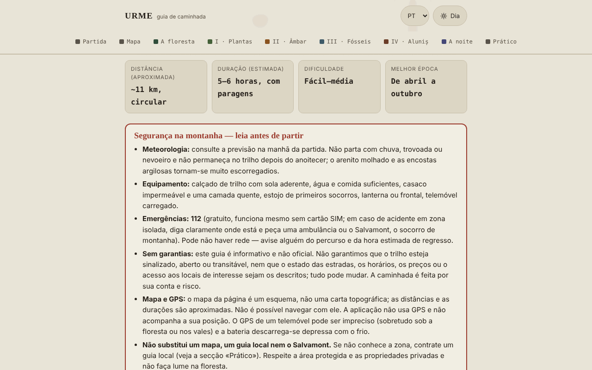

# URME — guia de caminhada Aluniș–Colți (Montes Buzău)

[English](README.md) · [Română](README.ro.md) · [Français](README.fr.md) · [Italiano](README.it.md) · [Español](README.es.md) · **Português** · [Deutsch](README.de.md) · [Magyar](README.hu.md)

**Versão:** 1.2.7 · **Última atualização:** 2026-10-26

Idiomas da interface: **Română, English, Français, Italiano, Español, Português (PT), Deutsch, Magyar**

Guia offline, num único ficheiro HTML, para uma caminhada circular com partida em Aluniș Retreat: floresta, plantas medicinais, âmbar, fósseis e o conjunto rupestre de Aluniș. Informativo e não oficial.

**Aplicação online:** https://chiuta.github.io/URME/

## O que é

O URME («Um dia nos estratos da montanha») é um guia para ler, não uma aplicação de navegação. Descreve um circuito de cerca de 11 km (estimativa, não medida com GPS) e de 5–6 horas, com paragens temáticas: a floresta e os seus habitantes, as plantas medicinais, o âmbar de Colți, os fósseis e o relevo, a Igreja de Pedra de Aluniș e uma secção sobre o céu noturno. A página começa com uma caixa de segurança e termina com uma secção «Practic» (Prático) (resumo, contactos publicados pelo organizador, fontes).

## Funcionalidades

Verificadas no código:
- Caixa visível «Siguranță în munte» (Segurança na montanha): meteorologia, equipamento, 112, ausência de garantias sobre a sinalização/estado do trilho, limites do mapa e do GPS.
- Mapa esquemático SVG próprio do circuito (sem mosaicos de mapa externos), com legenda; em ecrã estreito desloca-se lateralmente.
- Secção recolhível «In English — safety and essentials for visitors» (sob a caixa de segurança, `lang="en"`): tradução fiel da caixa «Siguranță în munte», dos dados básicos (distância, duração, dificuldade, época) e da lista «Ce iei cu tine» (O que leva consigo), sem informações novas; o resto da página permanece em romeno.
- Lista de equipamento com caixas de seleção e contador («X de 9 preparados»); as caixas assinaladas são agora guardadas no navegador (ver «Novidades»). O botão «Copiază ce îmi mai trebuie» (Copiar o que ainda me falta) copia para a área de transferência apenas os elementos por assinalar.
- Planeador do dia (secção «Pornire»): para uma data e uma hora de partida calcula localmente o nascer do sol, o pôr do sol e o crepúsculo civil (zona de Colți, aprox. 45,38° N, 26,40° E, segundo a Wikipédia, consultada a 11 de outubro de 2026), na hora da Roménia (com a mudança para a hora de verão/inverno), a partida mais tardia recomendada (6 h de percurso + 1 h de reserva) e a margem em relação ao pôr do sol para a estimativa de 5–6 h do guia; avisa se o regresso fosse depois do pôr do sol. Algoritmo astronómico simplificado, verificado a 11 de outubro de 2026 face a uma calculadora pública para Buzău (diferenças de poucos minutos, explicáveis pela localização); não tem em conta o relevo.
- Navegação por secções com realce da secção atual; comutador dia/noite (segue a definição do sistema ao abrir); estilo de impressão.
- Secções recolhíveis (história da mina, «Alte urme din jur» (Outros vestígios nos arredores), «De ce se numește URME» (Porque se chama URME)).

## Novidades (1.1.0)

- **Mapa do céu** (secção «Noaptea» (A noite)): escolhe a data e a hora (hora da Roménia, com a mudança para a hora de verão/inverno) e a aplicação desenha o céu sobre a zona Colți–Aluniș (aprox. 45,38° N, 26,40° E): estrelas até à magnitude 5 (1627 do catálogo Hipparcos), as figuras e os nomes romenos das constelações, o Sol, a Lua (com a fase desenhada) e os planetas de Mercúrio a Saturno. Sob o mapa surge uma tabela com a altura e o azimute dos astros, a fase da Lua, o seu nascer e pôr e uma indicação de «céu escuro» (Sol abaixo de −18° e Lua abaixo do horizonte). O cálculo é feito localmente, com as efemérides do `fff-kit` (erros medidos: menos de 3″ para o Sol, a Lua e os planetas face ao JPL DE421/423; ver `fff-kit/docs/ephem.md`).
  - **Limites:** não desenha a Via Láctea, as nuvens, a poluição luminosa nem o relevo (a montanha eleva o horizonte real); faltam as estrelas mais fracas do que a magnitude 5 e os planetas Úrano e Neptuno (não visíveis a olho nu). O mapa serve para planeamento, não para segurança.
- **A lista de equipamento é guardada** entre visitas (`localStorage`, chave `urme.gear`), tal como as caixas «Figuri» (Figuras) e «Nume» (Nomes) do mapa do céu (`urme.sky`). Pode fazer uma cópia de segurança `.fff.json` a partir da janela «Transparență» (Transparência) (prima a versão no rodapé).
- **Ficha de campo impressa** (secção «Pornire», botão «Tipărește fișa de teren» (Imprimir a ficha de campo)): uma página com a segurança, o 112, as horas de luz do planeador, a lista de equipamento com as suas caixas assinaladas e um código QR (gerado localmente) para o guia publicado. Sem JavaScript ou sem o módulo QR, a ficha não existe / surge sem código.
- **Transparência** (ao premir a versão no rodapé): rede (0 pedidos externos), chaves guardadas, ficheiro com SHA-256.

A interface tem 8 idiomas (RO, EN, FR, IT, ES, PT, DE, HU); o texto longo do guia permanece em romeno, e as traduções que não sejam romeno são automáticas e não verificadas por falantes nativos.

## O kit «fff-kit»

Módulos integrados no `index.html`: `core`, `label`, `bundle`, `qr`, `ephem`, `ephem-stars` (no total cerca de 455 kB para além do guia). Sem eles o guia continua plenamente funcional (testado): o mapa do céu não aparece. Dados e licenças do catálogo estelar: `fff-kit/THIRD-PARTY.md` (Hipparcos/ESA, d3-celestial BSD-3-Clause, hipparcos-catalog MIT). O `app.json` descreve a rede, as permissões e o SHA-256.

## Testes

`node tests/fff-r8.test.mjs` (Playwright, rede bloqueada; 69 verificações): a Lua cheia a 26 de outubro de 2026 e a Lua nova a 2 de agosto de 2027, o Sol ao pôr do sol no planeador (algoritmo NOAA independente) em quatro datas, Polaris a uma altura ≈ latitude, o fuso horário verão/inverno, a persistência das caixas assinaladas, o pacote `.fff.json`, a ficha e o modo de impressão (PDF de uma página), axe-core 0 violações (tema claro e escuro, 360 px, caixa de diálogo), sem o kit.

## Manual de utilização

1. Leia a caixa «Siguranță în munte» antes de planear a caminhada.
2. Percorra «Pornire» (o que leva consigo, regras, estações) e assinale a lista de equipamento.
3. Consulte «Hartă» (Mapa) para a ordem das paragens; não o use para navegar.
4. Leia as etapas (Plante, Chihlimbar, Fosile, Aluniș, Noaptea) pela ordem que desejar, a partir da barra de navegação.
5. Em «Practic» encontra o resumo e os contactos publicados pelo organizador (verifique-os diretamente).
6. Pode imprimir a página; o comutador dia/noite está no canto superior direito.

## Privacidade e rede

- **Armazenamento:** apenas `localStorage`, local no navegador: `urme.gear` (as caixas assinaladas da lista de equipamento) e `urme.sky` (duas preferências do mapa do céu). Não usa `sessionStorage`, IndexedDB nem cookies; pode apagar os dados em «Transparență».
- **Rede:** não faz qualquer pedido de rede (sem `fetch`, scripts, tipos de letra, imagens ou mapas externos). A CSP da página bloqueia as ligações externas. A única ligação externa é `tabara.asfan.online`, que só se abre se clicar nela.
- **Permissões:** não pede qualquer permissão (não usa geolocalização, câmara ou microfone). A aplicação não acompanha a sua posição.
- Não há conta, telemetria nem análise de tráfego.

## Limites e avisos

- Guia informativo, **não oficial**; não garante que o trilho esteja sinalizado, aberto ou transitável e não substitui o mapa topográfico, o guia local ou o Salvamont (socorro de montanha). Em caso de emergência: **112**.
- Mapa esquemático; as distâncias, durações e altitudes (~500–650 m) são indicativas e não foram medidas com GPS pelo autor.
- As plantas medicinais são apresentadas a partir da tradição popular, com fins educativos; **não constituem aconselhamento médico**. Não consuma plantas ou cogumelos que não consiga identificar com segurança; para qualquer uso terapêutico, peça a opinião de um médico ou farmacêutico.
- A zona entre Colți e Aluniș inclui uma área natural protegida; no seu interior é proibida a extração de âmbar ou de fósseis.
- Alguns dados históricos (os anos da igreja, dimensões, a mina de âmbar, a doação de 1578) provêm da tradição ou de fontes locais e diferem entre fontes; estão assinalados como não verificados no texto.
- Os contactos, o horário e as tarifas do organizador (Centrul de Artă Aluniș) são os por ele publicados e podem estar desatualizados. O guia não é feito pelo organizador.
- A secção sobre o acampamento ASFAN reflete a perspetiva dos organizadores; os fenómenos aeroespaciais não identificados não têm uma explicação científica confirmada.

## Execução local / offline

Descarregue `index.html` e abra-o num navegador; funciona sem internet.

## Histórico / Changelog

### 1.2.6 — 2026-10-23
- Planeador do dia: uma hora de regresso depois da meia-noite aparece agora como hora válida (p. ex. 01:00) em vez de 25:00–26:00 ou 28:30; o aviso «depois do pôr do sol» não muda.
- Em ecrãs táteis (`pointer: coarse`) os botões pequenos e os campos de data/hora têm uma área tátil de 44 px.

### 1.2.4 — 2026-10-22
- fff-kit 1.1.4: alvos táteis e texto mínimo; alvos táteis/texto corrigidos

### 1.2.3 — 2026-10-22
- fff-kit 1.1.2: PBKDF2 com 600.000 iterações, proteção anti-clickjacking.

### 1.2.2 — 2026-10-22
- Móvel: o texto tem pelo menos 12 px e os botões e campos têm áreas táteis maiores em ecrãs estreitos.

### 14 de outubro de 2026 (v1.1.0)
- Novo: mapa do céu com efemérides locais, lista de equipamento guardada, ficha de campo impressa com QR, janela «Transparență» (fff-kit: core, label, bundle, qr, ephem, ephem-stars); `tests/fff-r8.test.mjs`. CSP: hash do script recalculado, sem outras alterações.

### 12 de outubro de 2026 (v1.0.0)
- 1.0.0 — 2026-10-12: a versão e a data da última atualização são apresentadas na aplicação

### 11 de outubro de 2026 (terceira entrada)
- Resumo em inglês (segurança, dados básicos, equipamento) para visitantes que não leem romeno; axe 0 violações com a secção aberta, em tema claro e escuro, a 1280 e 360 px.

### 11 de outubro de 2026 (segunda entrada)
- Planeador do dia (nascer/pôr do sol/crepúsculo civil, partida mais tardia, margem em relação ao pôr do sol) e botão «Copiază ce îmi mai trebuie» para a lista de equipamento.
- Corrigido o texto de reserva «0 din 7 pregătite» (0 de 7 preparados) (a lista tem 9 elementos).

### 11 de outubro de 2026
- O horário e a tarifa do organizador (Centrul de Artă Aluniș) trazem agora, na aplicação, a menção de que não puderam ser reverificados a 11 de outubro de 2026 e de que a época indicada (até 1 de outubro) terminou.
- Verificação: axe 0 violações, sem transbordo horizontal a 360 px.

## Licença

MIT — ver o ficheiro `LICENSE`.

## Autor

Alexio — Alexandru-Ionuț Chiuță, contacto: alexio@trom.tf

## Resumo

O URME é um guia de caminhada offline em romeno, num único ficheiro, para um percurso circular de cerca de 11 km perto de Aluniș e Colți (Montes Buzău, Roménia): floresta, plantas medicinais, âmbar, fósseis e a igreja escavada na rocha de Aluniș. É informativo e não oficial, tem um aviso de segurança destacado, usa um mapa SVG esquemático (não serve para navegação), não usa GPS e não faz pedidos de rede; desde a 1.1.0 guarda apenas as marcas da lista de equipamento e duas preferências do mapa celeste em localStorage. Inclui um planeador local de luz do dia (nascer/pôr do sol para a zona de Colți) e um botão para copiar o equipamento em falta. Licenciado sob MIT.

Novidades na 1.1.0: uma carta celeste offline para a zona Colți–Aluniș (estrelas até à magnitude 5, figuras de constelações, Sol, Lua com fase, planetas de Mercúrio a Saturno; efemérides locais), uma lista de equipamento persistente, uma ficha de campo imprimível de uma página com código QR para o guia publicado e a caixa de diálogo «Transparência». Interface apenas em romeno; não é uma ferramenta de navegação.
