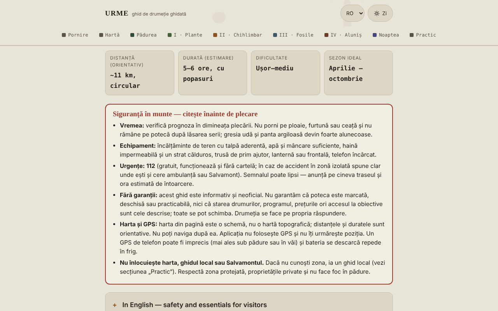

# URME — ghid de drumeție Aluniș–Colți (Munții Buzăului)

[English](README.md) · **Română** · [Français](README.fr.md) · [Italiano](README.it.md) · [Español](README.es.md) · [Português](README.pt.md) · [Deutsch](README.de.md) · [Magyar](README.hu.md)

**Versiune:** 1.2.0 · **Ultima actualizare:** 2026-10-19

Limbile interfeței: **Română, English, Français, Italiano, Español, Português (PT), Deutsch, Magyar**

Ghid offline, într-un singur fișier HTML, pentru o drumeție circulară care pornește de la Aluniș Retreat: pădure, plante de leac, chihlimbar, fosile și Ansamblul Rupestru Aluniș. Informativ și neoficial.

**Live:** https://chiuta.github.io/URME/

## Ce este

URME („O zi în straturile muntelui") este un ghid de citit, nu o aplicație de navigație. Descrie o buclă de aproximativ 11 km (estimare, nemăsurată cu GPS) și 5–6 ore, cu popasuri tematice: pădurea și viețuitoarele ei, plante de leac, chihlimbarul de la Colți, fosile și relief, Biserica din Piatră de la Aluniș și o secțiune despre cerul nopții. Pagina începe cu un chenar de siguranță și se termină cu o secțiune „Practic" (recapitulare, contacte publicate de organizator, surse).

## Funcții

Verificate în cod:
- Chenar vizibil „Siguranță în munte": vreme, echipament, 112, lipsa garanțiilor privind marcajul/starea traseului, limitele hărții și ale GPS-ului.
- Hartă schematică SVG proprie a buclei (fără plăci de hartă externe), cu legendă; pe ecran îngust se derulează lateral.
- Secțiune pliabilă „In English — safety and essentials for visitors” (sub chenarul de siguranță, `lang="en"`): traducerea fidelă a chenarului „Siguranță în munte”, a datelor de bază (distanță, durată, dificultate, sezon) și a listei „Ce iei cu tine”, fără informații noi; restul paginii rămâne în română.
- Listă de echipament cu bife și contor („X din 9 pregătite"); bifele se păstrează acum în browser (vezi „Funcții noi”). Butonul „Copiază ce îmi mai trebuie" copiază în clipboard doar elementele nebifate.
- Planificator de zi (secțiunea „Pornire"): pentru o dată și o oră de plecare calculează local răsăritul, apusul și amurgul civil (zona Colți, aprox. 45,38° N, 26,40° E, după Wikipedia, consultat la 11 octombrie 2026), în ora României (cu trecerea la ora de vară/iarnă), cea mai târzie plecare recomandată (6 h de traseu + 1 h rezervă) și marja față de apus pentru estimarea de 5–6 h din ghid; avertizează dacă revenirea ar fi după apus. Algoritm astronomic simplificat, verificat la 11 octombrie 2026 față de un calculator public pentru Buzău (diferențe de câteva minute, explicabile prin locație); nu ține cont de relief.
- Navigare pe secțiuni cu evidențierea secțiunii curente; comutator zi/noapte (urmărește setarea sistemului la deschidere); stil de tipărire.
- Secțiuni pliabile (istoria minei, „Alte urme din jur", „De ce se numește URME").

## Funcții noi (1.1.0)

- **Harta cerului** (secțiunea „Noaptea”): alegi data și ora (ora României, cu trecerea la ora de vară/iarnă) și aplicația desenează cerul de deasupra zonei Colți–Aluniș (aprox. 45,38° N, 26,40° E): stele până la magnitudinea 5 (1627 din catalogul Hipparcos), figurile și denumirile românești ale constelațiilor, Soarele, Luna (cu faza desenată) și planetele Mercur–Saturn. Sub hartă apare un tabel cu altitudinea și azimutul corpurilor, faza Lunii, răsăritul și apusul ei și o indicație „cer întunecat” (Soare sub −18° și Lună sub orizont). Calculul se face local, cu efemeridele din `fff-kit` (erori măsurate: sub 3″ pentru Soare, Lună și planete față de JPL DE421/423; vezi `fff-kit/docs/ephem.md`).
  - **Limite:** nu desenează Calea Lactee, norii, poluarea luminoasă sau relieful (muntele ridică orizontul real); lipsesc stelele mai slabe de magnitudinea 5 și planetele Uranus și Neptun (nu se văd cu ochiul liber). Harta este pentru planificare, nu pentru siguranță.
- **Lista de echipament se păstrează** între vizite (`localStorage`, cheia `urme.gear`), la fel bifele „Figuri” și „Nume” ale hărții cerului (`urme.sky`). Poți face copie de siguranță `.fff.json` din fereastra „Transparență” (apasă versiunea din subsol).
- **Fișă de teren tipărită** (secțiunea „Pornire”, butonul „Tipărește fișa de teren”): o pagină cu siguranța, 112, orele de lumină din planificator, lista de echipament cu bifele tale și un cod QR (generat local) către ghidul publicat. Fără JavaScript sau fără modulul QR, fișa lipsește / apare fără cod.
- **Transparență** (apăsând versiunea din subsol): rețea (0 cereri externe), chei salvate, fișier cu SHA-256.

Interfața are 8 limbi (RO, EN, FR, IT, ES, PT, DE, HU); textul lung al ghidului rămâne în română, iar traducerile în afară de română sunt automate și neverificate de vorbitori nativi.

## Kit „fff-kit”

Module lipite în `index.html`: `core`, `label`, `bundle`, `qr`, `ephem`, `ephem-stars` (în total ~455 kB peste ghid). Fără ele ghidul rămâne complet funcțional (testat): harta cerului nu apare. Date și licențe ale catalogului stelar: `fff-kit/THIRD-PARTY.md` (Hipparcos/ESA, d3-celestial BSD-3-Clause, hipparcos-catalog MIT). `app.json` descrie rețeaua, permisiunile și SHA-256.

## Teste

`node tests/fff-r8.test.mjs` (Playwright, rețea blocată; 69 de verificări): Luna plină la 26 octombrie 2026 și Luna nouă la 2 august 2027, Soarele la apusul din planificator (algoritm NOAA independent) pe patru date, Polaris la altitudine ≈ latitudine, fusul orar vară/iarnă, persistența bifelor, pachet `.fff.json`, fișă și mod tipărire (PDF de o pagină), axe-core 0 violări (temă luminoasă și întunecată, 360 px, dialog), fără kit.

## Manual de utilizare

1. Citește chenarul „Siguranță în munte" înainte de a plănui drumeția.
2. Parcurge „Pornire" (ce iei cu tine, reguli, anotimpuri) și bifează lista de echipament.
3. Consultă „Hartă" pentru ordinea popasurilor; nu o folosi pentru navigație.
4. Citește etapele (Plante, Chihlimbar, Fosile, Aluniș, Noaptea) în ordinea dorită, din bara de navigare.
5. În „Practic" găsești recapitularea și datele de contact publicate de organizator (verifică-le direct).
6. Poți tipări pagina; comutatorul zi/noapte e în colțul din dreapta sus.

## Confidențialitate și rețea

- **Stocare:** doar `localStorage`, local în browser: `urme.gear` (bifele din lista de echipament) și `urme.sky` (două preferințe ale hărții cerului). Nu folosește `sessionStorage`, IndexedDB sau cookie-uri; poți șterge datele din „Transparență”.
- **Rețea:** nu face nicio cerere de rețea (fără `fetch`, scripturi, fonturi, imagini sau hărți externe). Politica CSP din pagină blochează conexiunile externe. Singurul link extern este `tabara.asfan.online`, care se deschide doar dacă apeși pe el.
- **Permisiuni:** nu cere nicio permisiune (nu folosește geolocalizare, cameră sau microfon). Aplicația nu îți urmărește poziția.
- Nu există cont, telemetrie sau analiză de trafic.

## Limite și avertismente

- Ghid informativ, **neoficial**; nu garantează că poteca este marcată, deschisă sau practicabilă și nu înlocuiește harta topografică, ghidul local sau Salvamontul. În caz de urgență: **112**.
- Hartă schematică; distanțele, duratele și altitudinile (~500–650 m) sunt orientative și nu au fost măsurate cu GPS de către autor.
- Plantele de leac sunt prezentate din tradiția populară, cu rol educativ; **nu sunt sfat medical**. Nu consuma plante sau ciuperci pe care nu le poți identifica sigur; la orice utilizare terapeutică cere părerea unui medic sau farmacist.
- Zona dintre Colți și Aluniș include o arie naturală protejată; în interiorul ei extragerea chihlimbarului sau a fosilelor este interzisă.
- Unele date istorice (anii bisericii, dimensiuni, mina de chihlimbar, donația din 1578) provin din tradiție sau surse locale și diferă între surse; sunt marcate ca neverificate în text.
- Datele de contact, programul și tarifele organizatorului (Centrul de Artă Aluniș) sunt cele publicate de acesta și pot fi învechite. Ghidul nu este realizat de organizator.
- Secțiunea despre tabăra ASFAN reflectă perspectiva organizatorilor; fenomenele aerospațiale neidentificate nu au o explicație științifică confirmată.

## Rulare locală / offline

Descarcă `index.html` și deschide-l în browser; funcționează fără internet.

## Istoric / Changelog

### 14 octombrie 2026 (v1.1.0)
- Nou: harta cerului cu efemeride locale, lista de echipament salvată, fișă de teren tipărită cu QR, fereastra „Transparență” (fff-kit: core, label, bundle, qr, ephem, ephem-stars); `tests/fff-r8.test.mjs`. CSP: hash-ul scriptului recalculat, fără alte schimbări.

### 12 octombrie 2026 (v1.0.0)
- 1.0.0 — 2026-10-12: versiunea și data ultimei actualizări sunt afișate în aplicație

### 11 octombrie 2026 (a treia intrare)
- Rezumat în engleză (siguranță, date de bază, echipament) pentru vizitatori care nu citesc românește; axe 0 violări cu secțiunea deschisă, în temă luminoasă și întunecată, la 1280 și 360 px.

### 11 octombrie 2026 (a doua intrare)
- Planificator de zi (răsărit/apus/amurg civil, cea mai târzie plecare, marja față de apus) și buton „Copiază ce îmi mai trebuie" pentru lista de echipament.
- Corectat textul de rezervă „0 din 7 pregătite" (lista are 9 elemente).

### 11 octombrie 2026
- Programul și tariful organizatorului (Centrul de Artă Aluniș) au acum, în aplicație, mențiunea că nu au putut fi reverificate la 11 octombrie 2026 și că sezonul indicat (până la 1 octombrie) s-a încheiat.
- Verificare: axe 0 violări, fără depășire orizontală la 360 px.

## Licență

MIT — vezi fișierul `LICENSE`.

## Autor

Alexio — Alexandru-Ionuț Chiuță, contact: alexio@trom.tf

## Rezumat

URME este un ghid de drumeție offline într-un singur fișier, în limba română, pentru un traseu circular de ~11 km lângă Aluniș și Colți (Munții Buzăului, România): pădure, plante medicinale, chihlimbar, fosile și biserica rupestră de la Aluniș. Este informativ și neoficial, are o notă de siguranță vizibilă, folosește o hartă schematică SVG (nu pentru navigație), fără GPS, și nu face cereri de rețea; din 1.1.0 stochează în localStorage doar bifările listei de echipament și două preferințe ale hărții cerului. Include un planificator local de lumină (răsărit/apus pentru zona Colți) și un buton de copiere a echipamentului lipsă. Licență MIT.

Noutăți în 1.1.0: o hartă offline a cerului pentru zona Colți–Aluniș (stele până la magnitudinea 5, figuri de constelații, Soare, Lună cu fază, planetele Mercur–Saturn; efemeride locale), o listă persistentă de echipament, o fișă de teren tipăribilă pe o pagină, cu cod QR către ghidul publicat, și dialogul „Transparență”. Interfață doar în română; nu este un instrument de navigație.
